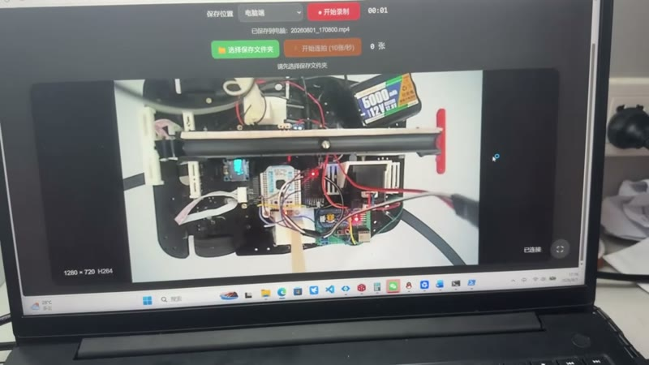
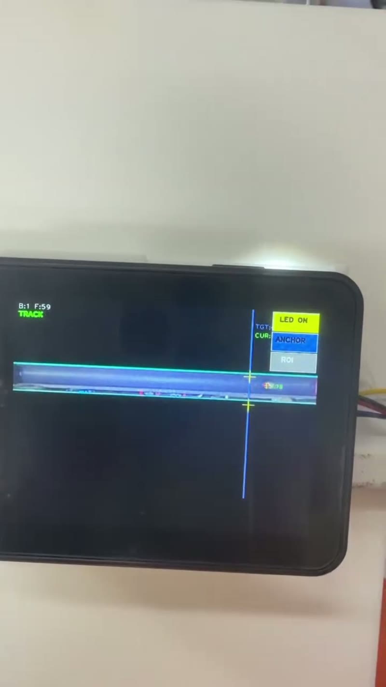

# 电赛 H 题 · 循线小车 + 钢珠平衡（STM32F103ZET6）

2026 年 TI 杯四川省大学生电子设计竞赛 **H 题**参赛作品，获**四川省二等奖**。

小车沿黑线循迹行驶的同时，用摄像头检测 PPR 水管内钢珠的位置，控制横梁倾角使钢珠保持在管中心 **±1 cm** 内。

## 演示

| 整机联调（车端摄像头画面） | 视觉跟踪（K230 端 TRACK 界面） |
|---|---|
|  |  |

更多画面见 `docs/frames/`，完整视频：`docs/video/demo-1.mp4`（整机运行）、`docs/video/demo-2.mp4`（K230 视觉跟踪）。

## 硬件组成

| 部分 | 器件 / 说明 |
|---|---|
| 主控 | STM32F103ZET6，CubeMX + HAL 库 |
| 视觉 | 摄像头模块，串口输出钢珠位置与速度 |
| 循迹 | 8 路灰度传感器（No_Mcu_Ganv 方案） |
| 横梁执行 | 步进电机 + Emm_V5 闭环驱动器 |
| 车轮 | 直流电机 + 编码器测速 |
| 姿态 | IMU（串口） |
| 人机 | OLED 显示、按键 |

## 软件结构

| 模块 | 主要文件 | 作用 |
|---|---|---|
| 主流程 | `main.c`、`question.c` | 20 ms 控制节拍、各问流程调度 |
| 速度环 | `PID.c`、`Motor.c`、`Encode.c` | 左右轮速度 PID，TIM4 双通道 PWM 输出 |
| 循迹 | `Line.c`、`No_Mcu_Ganv_Grayscale_Sensor.c` | 灰度质心求线位置偏差 + PD 转向 |
| 钢珠平衡 | `rect_midpoint_tracker.c`、`stepper_motor.c`、`Emm_V5.c` | 视觉位置 → 偏差解算 → 横梁倾角闭环 |
| 姿态 | `imu.c` | 偏航角与加速度 |
| 其他 | `oled.c`、`key.c`、`delay.c`、`hardware_iic.c` | 显示、交互、时基、软 I2C |

控制节拍集中在 `main.c` 的定时器回调里：TIM 每 20 ms 置标志位，主循环统一执行一次控制决策；中断只负责采数与发脉冲。

## 我负责的部分

- **视觉与控制**：钢珠位置检测与偏差解算、横梁倾角闭环的参数整定
- **硬件**：用立创 EDA 完成集成板原理图与双层 PCB，打样焊接后上机联调

## 编译

- Keil MDK：打开 `MDK-ARM/CAR.uvprojx`
- CubeMX 工程：`car.ioc`

> 仓库不含编译产物（`.gitignore` 已排除 `MDK-ARM/CAR/`），克隆后需自行编译。